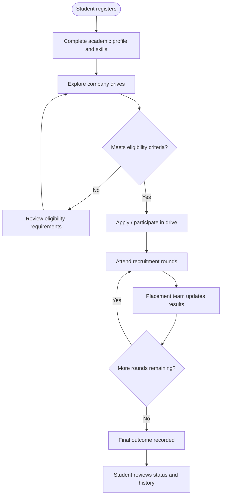
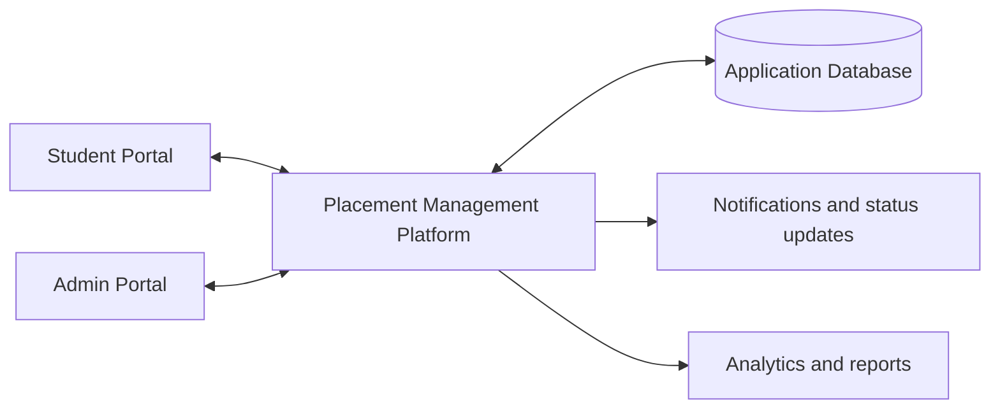
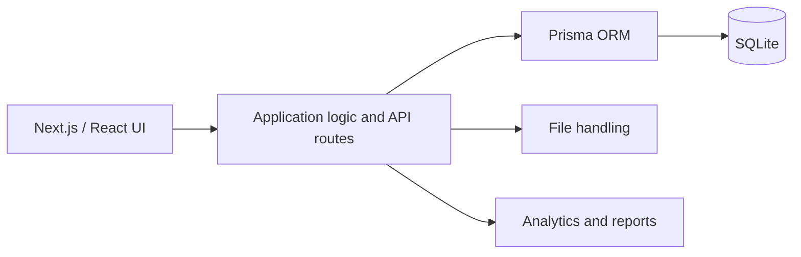
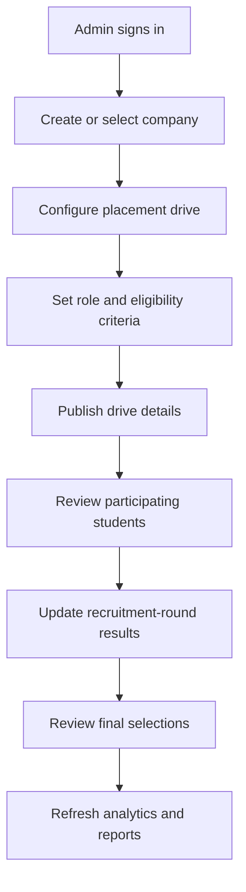
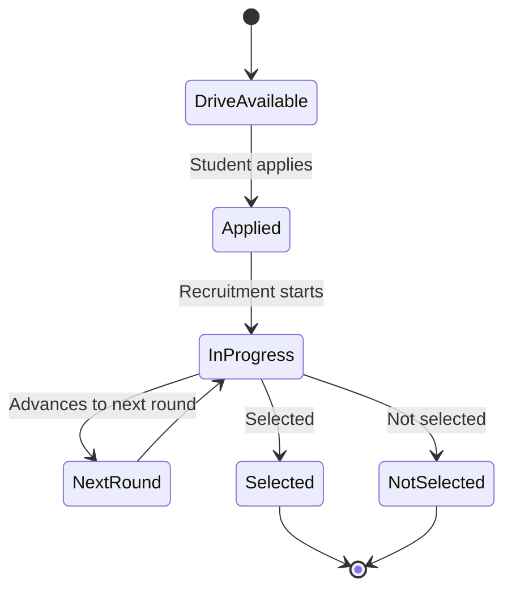

<div align="center">


# VSBEC Track
### Campus Placement Management System

**One workspace for students to track opportunities and placement officers to coordinate recruitment.**

Built for the placement workflow of **V.S.B. Engineering College, Karur**.

<p>
  
  
  
  
  
</p>

</div>

---

## ✨ Overview

VSBEC Track is a campus placement management platform designed to bring student profiles, company drives, recruitment progress, and placement reporting into one organized workspace.

It provides two role-focused experiences:

- **Student portal:** maintain a profile, manage skills, explore placement drives, follow recruitment rounds, and review placement history.
- **Admin portal:** manage student and company records, configure drives and eligibility, update round outcomes, and review placement analytics.

## 🎯 At a glance

| Student experience | Placement team experience |
| --- | --- |
| Profile and academic details | Student and company management |
| Skills and resume information | Drive setup and eligibility rules |
| Browse and apply for drives | Recruitment-round updates |
| Track round status and outcomes | Analytics and placement reports |
| Notifications and placement history | Audit history and system settings |

## 🧭 Visual guide

### 1. Placement lifecycle



### 2. Two portals, one coordinated process



The student portal is focused on individual progress. The admin portal supports coordination across students, companies, drives, recruitment rounds, and reporting.

### 3. High-level technical architecture



This is a conceptual view of the stack described for the project. Refer to the source code and environment configuration for deployment-specific details.

### 4. Admin drive-management workflow



### 5. Recruitment status flow



The exact status labels and transitions depend on the drive configuration used by the application.

---

## 🚀 Key capabilities

### Student portal
- Personalized dashboard for placement progress.
- Profile, academic information, skills, resume, certifications, and projects.
- Company and drive discovery with eligibility information.
- Recruitment-round status tracking and placement history.
- Notifications for drive updates and results.
- Account preferences and supported settings.

### Admin portal
- Dashboard with placement overview metrics.
- Student records and bulk-import support.
- Company and placement-drive management.
- Eligibility configuration and recruitment-round result updates.
- Placement analytics with department, year, and company views.
- Exportable reports, audit logs, and system settings.

## 🛠️ Technology stack

| Layer | Technologies |
| --- | --- |
| Web application | Next.js, React, TypeScript |
| UI and styling | Tailwind CSS, shadcn/ui |
| Data access | Prisma ORM |
| Database | SQLite |
| Charts and tables | Recharts, TanStack Table |
| Forms and validation | React Hook Form, Zod |
| Client state | Zustand |

## ⚙️ Run locally

### Prerequisites
- Node.js 18 or newer
- npm (or Bun)

### 1. Clone the repository
```bash
git clone https://github.com/Praveenofficial12/vsbec-track.git
cd vsbec-track
```

### 2. Install dependencies
```bash
npm install
```

### 3. Configure environment
Create a `.env` file in the project root and configure the database URL required by your local setup. For example:

```env
DATABASE_URL="file:./dev.db"
```

Check the project's Prisma schema and existing scripts before changing the database path.

### 4. Generate Prisma client and prepare the database
Run the database scripts defined in `package.json`. In projects where these scripts are configured as described, the commands may be:

```bash
npm run db:generate
npm run db:push
```

### 5. Start the development server
```bash
npm run dev
```

Open [http://localhost:3000](http://localhost:3000).

> **Setup note:** Available scripts, environment variables, and database paths can vary by checkout. If a command is not defined in `package.json`, use the equivalent script documented in the repository.

## 🔐 Security and responsible data handling

The application describes role-separated student and admin experiences, session management, and administrative activity tracking. When demonstrating or deploying the system:

- Use demo data in public screenshots and presentations.
- Never commit passwords, API keys, database files, or private student information.
- Keep production environment variables out of source control.
- Review authentication, authorization, file-upload validation, and session handling before public deployment.
- Follow college policies for handling student records.

## 🤝 Contributing

Suggestions, bug reports, and improvements are welcome. Please keep changes focused, document any setup changes, and avoid including secrets or real student records in commits.

---

<div align="center">

**VSBEC Track**  
*Making campus placement progress easier to coordinate and understand.*

[Repository](https://github.com/Praveenofficial12/vsbec-track) · Built for V.S.B. Engineering College, Karur

</div>
