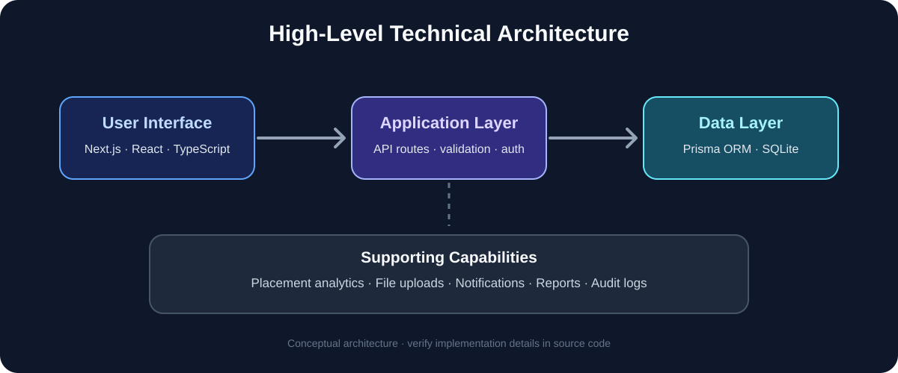

<div align="center">


# 🎓 VSBEC Track
### Placement Management System

<p align="center">
  <strong>A full-stack, production-ready campus placement portal built for V.S.B. Engineering College</strong><br/>
  Empowering students & placement officers with real-time drive tracking, analytics, and smart recommendations.
</p>

---

[](https://nextjs.org/)
[](https://www.typescriptlang.org/)
[](https://www.prisma.io/)
[](https://tailwindcss.com/)
[](https://www.sqlite.org/)
[](https://ui.shadcn.com/)

</div>

---

## 📋 Table of Contents

- [✨ Overview](#-overview)
- [🚀 Features](#-features)
- [🏗️ Tech Stack](#️-tech-stack)
- [📁 Project Structure](#-project-structure)
- [⚙️ Getting Started](#️-getting-started)
- [🗄️ Database Schema](#️-database-schema)
- [👥 User Roles](#-user-roles)
- [📡 API Reference](#-api-reference)
- [🔒 Security Features](#-security-features)
- [📊 Analytics & Reporting](#-analytics--reporting)
- [🤝 Contributing](#-contributing)

---

## ✨ Overview

**VSBEC Track** is a comprehensive, single-page placement management system designed to streamline the entire campus recruitment lifecycle — from student registration to final placement. Built with **Next.js 16**, **Prisma ORM**, and **SQLite**, it provides two dedicated portals:

- 🎓 **Student Portal** — Apply to drives, track round results, manage profiles & skills
- 🛡️ **Admin Portal** — Manage companies, drives, students, analytics, reports & system settings

> Built specifically for the Placement & Training Department of **V.S.B. Engineering College, Karur**.

---

## 🖼️ Visual Project Guide

These diagrams make the system easier to understand at a glance. They are **illustrative diagrams**, not screenshots of a running deployment.

### Placement workflow


Students register and maintain their profiles, explore eligible placement drives, follow each recruitment round, and review their final outcome. Placement officers manage drives and update results through the admin portal.

### Student and admin portals


The student portal focuses on profiles, applications, and tracking. The admin portal focuses on student/company management, drive configuration, results, analytics, and reports.

### Technical architecture



The project README identifies Next.js, React, TypeScript, API routes, Prisma ORM, and SQLite as key technologies. This is a high-level conceptual view; consult the source code for implementation specifics.

### Recommended real application screenshots

For a stronger project presentation, add genuine screenshots from your running app to `docs/images/screenshots/` and embed them here. Capture these screens using demo data and hide personal information, credentials, email addresses, and private student records:

1. **Landing / login page** — show the project branding and student/admin entry points.
2. **Student dashboard** — show overview cards and placement status.
3. **Company and drive listing** — show available drives and eligibility information.
4. **Drive tracking page** — show recruitment rounds and example statuses.
5. **Admin dashboard** — show placement KPIs and analytics charts.
6. **Drive management page** — show how an officer updates rounds or announcements.
7. **Reports page** — show export/report options, with all real student data obscured.

When screenshots are available, embed them with relative Markdown paths, for example:

    

---

## 🚀 Features

### 🎓 Student Portal

| Feature | Description |
|---|---|
| **Dashboard** | Personalized overview — active drives, placement status, recent notifications |
| **Profile Management** | Academic info, personal details, resume upload, profile photo, social links (LinkedIn, GitHub, LeetCode) |
| **Skills Manager** | Add / manage skills and strong skills with tag-based UI |
| **Company Explorer** | Browse companies, view job roles, CTC, eligibility criteria and apply for drives |
| **Drive Tracker** | Real-time round-by-round status tracking (Aptitude → Coding → GD → Technical HR → HR) |
| **Placement History** | Full timeline of past drive participations and results |
| **Notifications** | Real-time notifications for drive announcements, round results, and deadlines |
| **Settings** | Password change, theme toggle (Dark / Light), account preferences |

### 🛡️ Admin Portal

| Feature | Description |
|---|---|
| **Dashboard** | Real-time KPIs — total students, placed count, active drives, average CTC |
| **Student Management** | Full CRUD, bulk import via Excel/CSV, eligibility control, account lock/unlock |
| **Company Management** | Add companies with logos, job roles, industry, CTC and eligibility details |
| **Drive Management** | Create multi-round drives, set eligibility filters, manage round statuses |
| **Drive Detail** | Manage participants, update round results, share files & links, make announcements |
| **AI Recommendations** | Smart student-to-drive matching based on skills, CGPA, and eligibility |
| **Analytics** | Department-wise, year-wise, company-wise placement stats with charts |
| **Reports** | Exportable placement reports (Excel / DOCX) |
| **Audit Logs** | Full history of every admin action for compliance |
| **Student Activity** | Per-student activity timeline (logins, page visits, actions) |
| **Restricted Actions** | Unlock student accounts, manage screenshot policy, placement rules |
| **Settings** | College config, admin password, email notifications, custom eligibility fields |

---

## 🏗️ Tech Stack

```
Frontend        Next.js 16 (App Router) · React 19 · TypeScript 5
Styling         Tailwind CSS v4 · shadcn/ui · Framer Motion
State           Zustand (global client state)
Database        SQLite (via Prisma ORM 6)
Charts          Recharts
Tables          TanStack Table v8
Forms           React Hook Form + Zod validation
File Handling   JSZip · Mammoth · xlsx · docx
Email           Nodemailer
Auth            Custom session + heartbeat system
```

---

## 📁 Project Structure

```
vsbec-track/
├── prisma/
│   └── schema.prisma          # Full DB schema (15+ models)
├── src/
│   ├── app/
│   │   ├── page.tsx           # SPA router — all views in one page
│   │   ├── globals.css        # Global styles & design tokens
│   │   └── api/               # Next.js API routes
│   │       ├── auth/          # Login, register, logout, heartbeat
│   │       ├── students/      # Student CRUD & bulk import
│   │       ├── companies/     # Company management
│   │       ├── drives/        # Drive lifecycle management
│   │       ├── analytics/     # Placement analytics
│   │       ├── reports/       # Export reports
│   │       ├── certifications/# Student certifications
│   │       ├── projects/      # Student projects
│   │       ├── notifications/ # Push notifications
│   │       ├── audit-logs/    # Admin audit trail
│   │       ├── recommendations/# AI-based student matching
│   │       ├── settings/      # System configuration
│   │       └── log-activity/  # User activity tracking
│   ├── components/
│   │   ├── admin/             # 15 admin page components
│   │   ├── student/           # 10 student page components
│   │   ├── auth/              # Login, Register forms
│   │   ├── landing/           # Public landing page
│   │   ├── common/            # Shared components
│   │   └── ui/                # 48 shadcn/ui base components
│   ├── lib/
│   │   ├── db.ts              # Prisma client singleton
│   │   ├── types.ts           # Shared TypeScript interfaces
│   │   ├── store.ts           # Zustand global state
│   │   ├── api.ts             # API utility functions
│   │   ├── college.ts         # College config helpers
│   │   ├── activity.ts        # Activity logging
│   │   └── email-notifications.ts  # Email helpers
│   └── hooks/
│       ├── use-session-heartbeat.ts  # Single-session enforcement
│       └── use-mobile.ts
├── db/                        # SQLite database files
├── upload/                    # Student-uploaded files (resume, photos)
├── public/uploads/            # Drive files (admin-shared)
├── scripts/                   # DB backup & migration scripts
└── .env                       # Environment variables
```

---

## ⚙️ Getting Started

### Prerequisites

- **Node.js** ≥ 18
- **npm** or **bun**

### 1. Clone the repository

```bash
git clone https://github.com/Praveenofficial12/vsbec-track.git
cd vsbec-track
```

### 2. Install dependencies

```bash
npm install
# or
bun install
```

### 3. Configure environment

Create a `.env` file in the root:

```env
DATABASE_URL=file:../db/custom.db
```

### 4. Set up the database

```bash
# Generate Prisma client
npm run db:generate

# Push schema to SQLite
npm run db:push
```

### 5. Run the development server

```bash
npx next dev -p 3000
```

Open [http://localhost:3000](http://localhost:3000) in your browser.

### 6. Default Admin Credentials

> The default admin account is seeded during first run. Check `/scripts/` or contact the placement office for credentials.

---

## 🗄️ Database Schema

The system uses **SQLite** via **Prisma ORM** with the following core models:

```
Student              ─── Academic info, skills, resume, placement status
Company              ─── Company details, job roles, CTC
Drive                ─── Placement drives with eligibility filters
Round                ─── Individual rounds within a drive
DriveParticipation   ─── Student ↔ Drive relationship with results
RoundResult          ─── Per-round status per student
Certification        ─── Student certifications
Project              ─── Student projects
Notification         ─── Real-time student notifications
AdminUser            ─── Admin accounts
AuditLog             ─── Admin action audit trail
PlacementRule        ─── Configurable placement policies
UserActivityLog      ─── Full user activity tracking
SessionTracker       ─── Single-session enforcement
DriveFile            ─── Files attached to drive announcements
DriveLink            ─── External links shared by admin
CustomField          ─── Dynamic custom eligibility fields
```

---

## 👥 User Roles

### 🎓 Student
- Self-registers with register number & college email
- Can view and apply to open placement drives
- Tracks real-time round-by-round status
- Manages profile, skills, certifications, and projects
- Receives notifications for all drive events

### 🛡️ Admin (Placement Officer)
- Full control over students, companies, and drives
- Can bulk-import students from Excel/CSV
- Configures drive eligibility rules per department, year, CGPA, backlogs
- Manages multi-round drives with announcement boards
- Views analytics, exports reports, and maintains audit logs
- Can lock/unlock student accounts and manage screenshot policy

---

## 📡 API Reference

All APIs are under `/api/`:

| Endpoint | Method | Description |
|---|---|---|
| `/api/auth/login` | POST | Student / Admin login |
| `/api/auth/register` | POST | Student registration |
| `/api/auth/logout` | POST | Logout & clear session |
| `/api/auth/heartbeat` | POST | Session keepalive |
| `/api/students` | GET/POST | List / create students |
| `/api/students/[id]` | GET/PUT/DELETE | Student detail CRUD |
| `/api/companies` | GET/POST | List / create companies |
| `/api/drives` | GET/POST | List / create drives |
| `/api/drives/[id]` | GET/PUT/DELETE | Drive detail CRUD |
| `/api/participations` | GET/POST | Drive participation |
| `/api/certifications` | GET/POST | Student certifications |
| `/api/projects` | GET/POST | Student projects |
| `/api/notifications` | GET/POST | Notifications |
| `/api/analytics` | GET | Placement analytics data |
| `/api/reports` | GET | Export placement reports |
| `/api/recommendations` | GET | AI-based student matching |
| `/api/audit-logs` | GET | Admin audit logs |
| `/api/settings` | GET/POST | System settings |
| `/api/log-activity` | POST | Log user activity |
| `/api/files` | POST/DELETE | File upload / delete |

---

## 🔒 Security Features

| Feature | Details |
|---|---|
| **Single-Session Enforcement** | Only one active browser tab per user. Second login triggers instant logout of the first session via heartbeat mechanism |
| **Screenshot Policy** | Students attempting to take screenshots inside the portal receive 2 warnings; on the 3rd attempt, their account is locked automatically |
| **Account Locking** | Admin can lock/unlock student accounts manually or via automated screenshot policy |
| **Audit Trail** | Every admin action (create, update, delete, unlock) is logged with timestamps |
| **Session Heartbeat** | Sessions expire after 30s of inactivity; stale sessions are auto-cleared |
| **Role-Based Access** | Student and Admin views are strictly separated; unauthorized access redirects to login |

---

## 📊 Analytics & Reporting

The **Admin Analytics** module provides:

- 📈 **Overview KPIs** — Total students, eligible students, placed count, placement %, average CTC, highest CTC
- 🏢 **Company-wise** — Selections per company, CTC offered
- 🎓 **Department-wise** — Placement breakdown by department
- 📅 **Year-wise** — Placement trends across academic years
- 🛠️ **Skill Analytics** — Most in-demand skills, strong skill distribution
- 🔢 **Placement Funnel** — Registered → Attending → In-progress → Selected

**Export Formats:**
- 📊 Excel (`.xlsx`) — Full student placement data
- 📄 Word (`.docx`) — Formatted placement report

---

## 🤝 Contributing

This project is developed and maintained by the placement team at **V.S.B. Engineering College**.

```
Institution  : V.S.B. Engineering College, Karur
Department   : Placement & Training Cell
Maintained by: Placement Officers & Student Dev Team
```

---

<div align="center">

Made with ❤️ for **V.S.B. Engineering College**

⭐ Star this repo if you find it useful!

</div>
